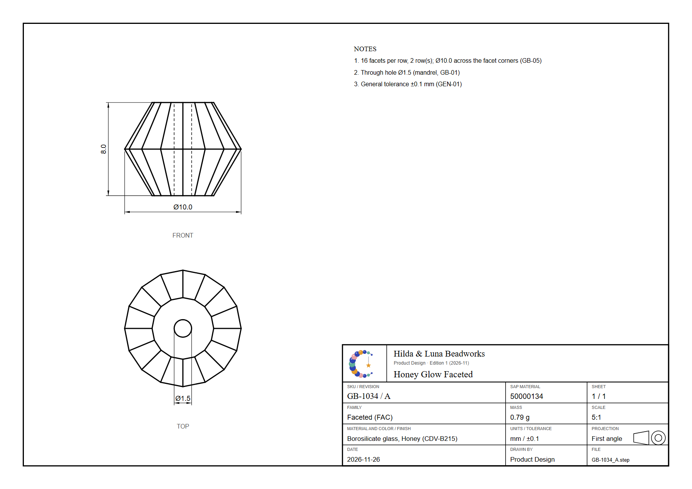
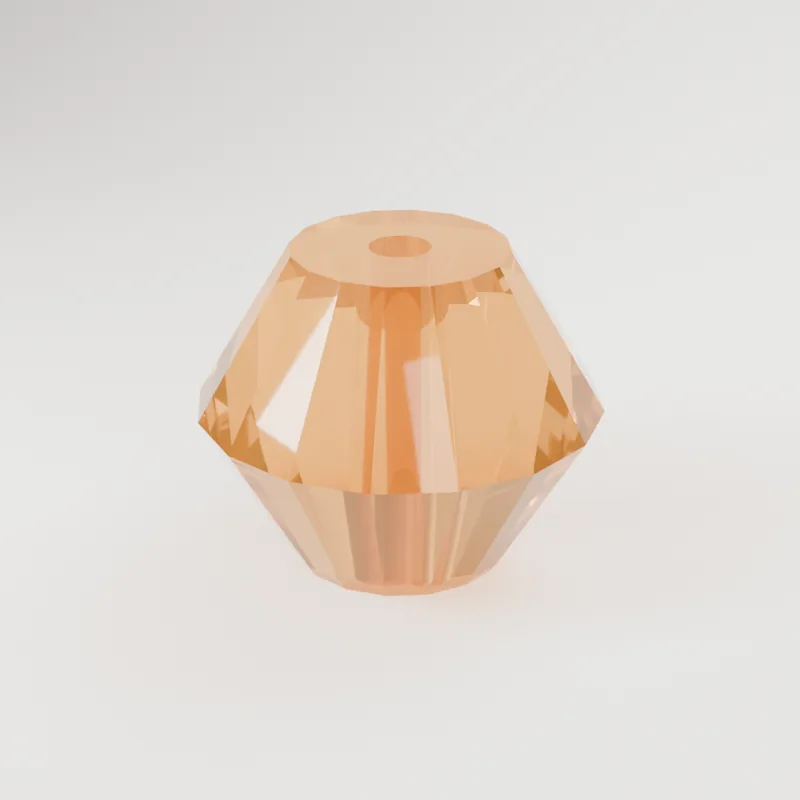
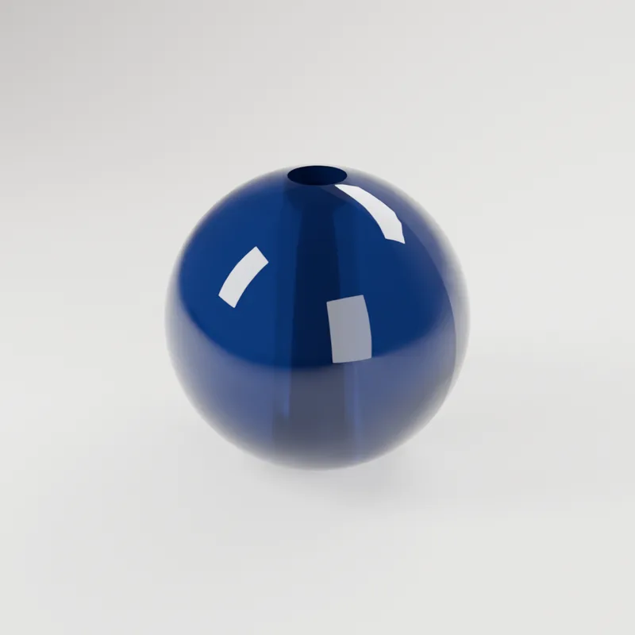
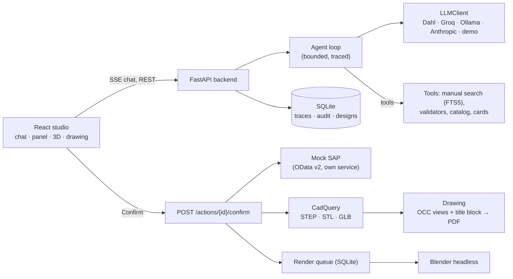
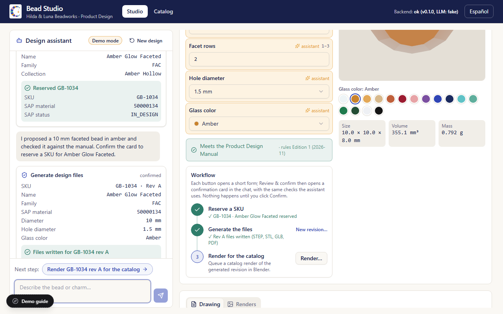
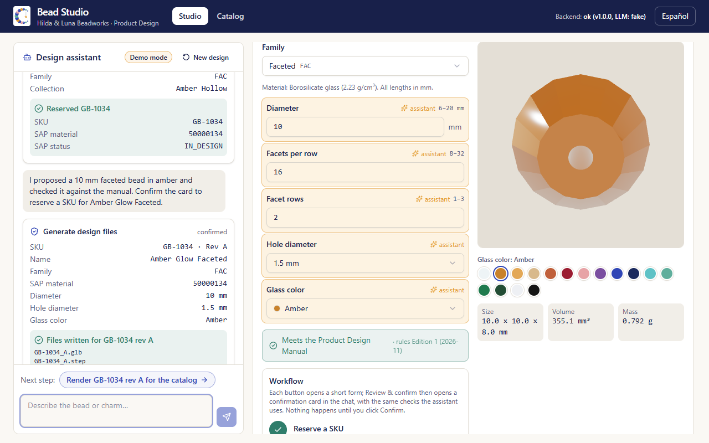
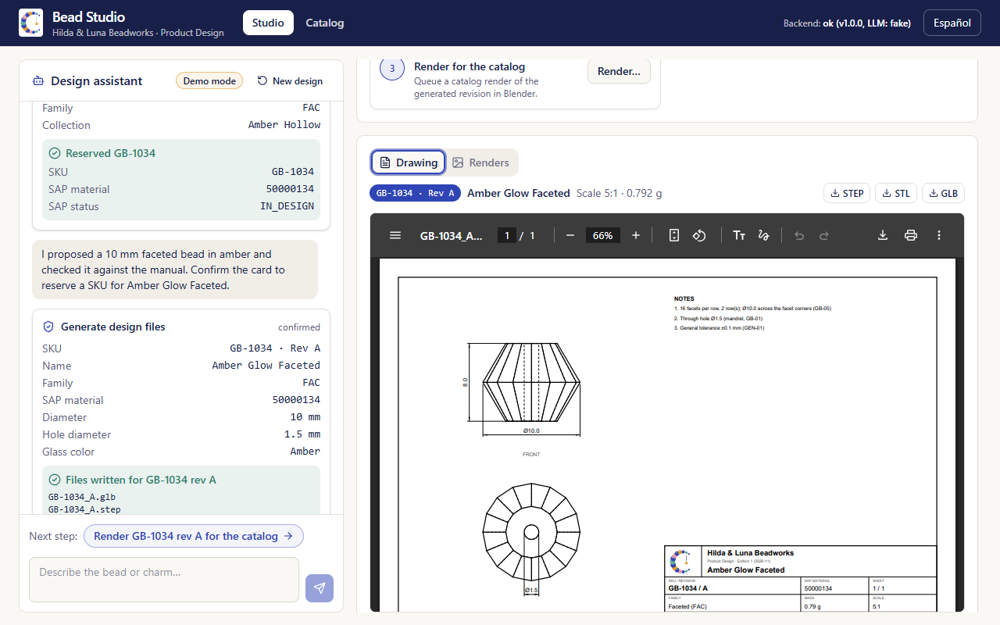
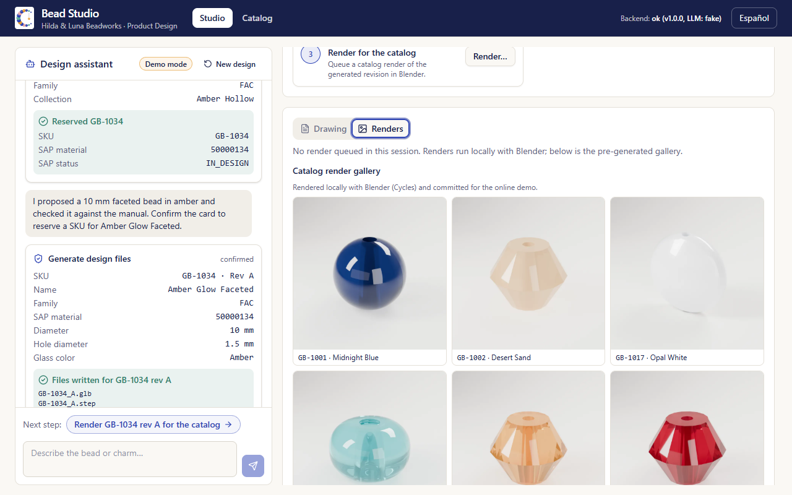
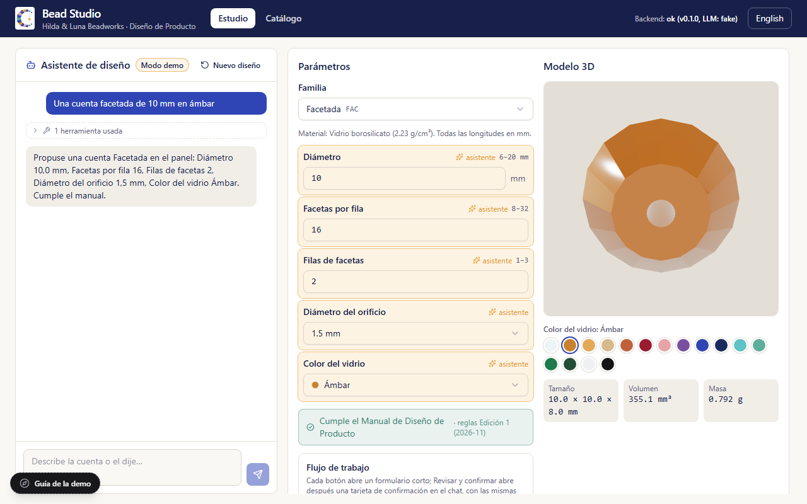

# Bead Studio

[](https://github.com/carlosgild-web/hl-bead-studio/actions/workflows/ci.yml)
[](LICENSE)


An AI-assisted internal tool for the Product Design team of **Hilda & Luna Beadworks**, a
fictional bead-making company. A designer describes a glass bead or charm; the assistant
proposes parameters and explains the rules from the company's Product Design Manual. After the
designer clicks **Confirm**, the studio reserves a SKU in a mock SAP, builds the 3D model with
CadQuery (STEP, STL, GLB), draws the technical drawing with the H&L title block and queues a
catalog render in Blender. **The AI guides; the code decides.**


<sub>Recorded in demo mode. The checks, the geometry and the drawing are real.</sub>

### The 2¾-minute video: a real model, under the hood

https://github.com/user-attachments/assets/6efe5239-311a-418f-9eb8-fb8e67a50b90

A real model (Groq, `gpt-oss-120b`), with the code and the data behind each step on the
right. It ends with the STEP file in FreeCAD while Blender renders the catalog image. What it
shows and how it was recorded: [docs/video.md](docs/video.md).

```bash
git clone https://github.com/carlosgild-web/hl-bead-studio.git
cd hl-bead-studio
start.cmd          # Windows      (./start.sh on Linux and macOS)
```

No API key and no Docker needed: without a model, demo mode answers from a curated
[Q&A bank](docs/qa/). It is not AI, but it fills the panel from a sentence through the real
validators, answers questions from the manual with a rule id, and the workflow's cards still
reserve, generate and render. [More options below](#try-it).

Built by **Carlos Velazquez** · [LinkedIn](https://www.linkedin.com/in/carlos-v-90b99149) · open to AI engineering roles (remote)

## What this demonstrates

- **Agent design without a framework**: a bounded, traced tool loop
  ([`backend/app/agent/loop.py`](backend/app/agent/loop.py)) whose tools only read, validate
  or open a card; side effects wait for a click.
- **The rules as code**: the Product Design Manual runs as deterministic validators
  ([`backend/app/standards/validators.py`](backend/app/standards/validators.py)); a violation
  shows its rule id and the nearest valid values, whatever the model said.
- **From a sentence to manufacturing files**: CadQuery geometry (STEP, STL, GLB), OpenCascade
  hidden-line drawings with the company title block, and Blender headless renders from a job
  queue.
- **Evaluation, not a demo**: 30 design scenarios and 92 Q&A questions scored on traces and
  side effects, run on Anthropic, Dahl, Groq and a 4B model on a laptop CPU; the failures are
  published in [`docs/eval/`](docs/eval/).
- **A model layer that degrades gracefully**: a startup check, a fallback chain and a demo
  mode that keeps the studio usable with no model at all.
- **Full stack and delivery**: FastAPI, React + TypeScript + react-three-fiber, a mock SAP
  OData v2 service, Docker, about 1,500 tests and Playwright end-to-end tests in GitHub Actions.

## The problem

A new bead starts as a sentence ("a 10 mm faceted amber bead") and ends as files a workshop
can use: exact dimensions, a hole that fits the mandrels, a drawing, a SKU in the ERP and a
catalog image. In between, a designer checks the idea against a manual of rules (hole sizes,
wall thickness, facet widths, engraving detail, naming) and types the same data into several
tools.

Bead Studio takes this to one panel and three clicks:

- **The assistant** turns the sentence into a first set of parameters and explains the rules
  in plain words, citing the manual. It explains; it never decides.
- **The manual's rules run as code** on every edit: a violation names its rule (GB-05, CH-02…)
  and offers the nearest valid values.
- **SAP issues the SKU** and the material number on the first click. Nobody types a number by
  hand, and a taken product name is caught before it reaches SAP.
- **The files follow**: STEP, STL and GLB, a PDF drawing with the H&L title block, and a
  catalog render in the approved glass color or plating.

## Before and after

The designer's sentence:

> A 10 mm faceted amber bead for the Amber Hollow collection; reserve a SKU for it

The drawing Bead Studio produces from it, with the views, the dimensions, the rules it meets
and the H&L title block ([PDF](docs/showcase/GB-1034_A_drawing.pdf)):



And catalog renders from the same pipeline, in Blender ([gallery](docs/gallery/)):

<p>




</p>

## The AI guides; the code decides

A model is good at reading a sentence and explaining a rule. It must not be the one who
decides that a design can be made, invent a dimension, or reserve a number in SAP. Nine
invariants keep that line; each is enforced in code and covered by tests (in
`backend/tests/` unless the path says otherwise):

| # | Invariant | Where it is enforced |
|---|---|---|
| 1 | **Rules are code.** Parameter validity is decided by the validators against the manual; the model proposes and explains. | `backend/app/standards/validators.py`, `test_validators.py`, e2e "a 0.5 mm hole breaks GB-01, and the nearest mandrel fixes it" |
| 2 | **Confirmation gate.** Reserving a SKU, writing design files and queuing a render happen only in `POST /api/actions/{id}/confirm`, after the designer's click; the stored arguments are checked again. The model can only open a card. | `backend/app/actions.py`, `test_agent_gate.py` (`test_confirm_validates_the_stored_arguments_again`, `test_an_action_is_confirmed_at_most_once`) |
| 3 | **Numbers come from tools.** Dimensions, volume, mass and rule limits come from tool results; the eval checks the parameters (to 0.05 mm), the cited rule ids and the numbers. | `backend/app/eval/score.py`, `test_agent_eval.py`, `test_qa_bank.py` (`test_every_number_in_an_english_answer_is_in_the_manual`) |
| 4 | **Confined writes.** Every generated file resolves inside `DESIGNS_ROOT`; SKU and revision are validated before they become path segments. | `confined` in `backend/app/core/paths.py`, `test_confined_rejects_paths_that_leave_the_root`, `test_invalid_identifiers_never_reach_the_file_system` |
| 5 | **SAP only through `SapClient`**; model APIs only under `backend/app/llm/`. A real SAP Gateway could replace the mock. | `backend/app/sap/client.py`, `test_sap_client.py` |
| 6 | **External processes are bounded.** Blender runs as a subprocess with a timeout, an argument list (no shell) and captured logs. | `backend/app/render/runner.py`, `test_render_jobs.py` (`test_blender_runs_without_a_shell_and_with_factory_settings`, `test_a_failed_run_fails_the_job`) |
| 7 | **Traced and bounded agent.** Every run stops at `AGENT_MAX_ITERATIONS` and stores a trace of model calls, tool calls and results. | `backend/app/agent/loop.py`, `trace.py`, `test_the_loop_stops_at_the_iteration_limit`, `test_every_run_stores_a_trace` |
| 8 | **Free text is data.** Product names, descriptions and engraved text never become instructions; three eval scenarios inject instructions through them. | `test_agent_gate.py` (`test_injection_in_a_product_name_is_rejected_by_gen03`, `test_user_text_and_panel_are_quoted_as_data`), e2e "an instruction as the product name is refused and reserves nothing" |
| 9 | **Audit.** Every reserved SKU, generated design and render writes an `audit_log` row. | `write_audit` in `backend/app/db/audit.py`, `test_writes_an_audit_row`, `test_valid_bead_from_description_to_render` |

## How it works



- **The agent** is a small loop written for this project, with no framework. Its tools search
  the manual, look up the catalog, validate parameters and names, or *open* a confirmation
  card. None of them has a side effect. [More](docs/assistant.md).
- **The mock SAP** (`sap-mock/`) is a separate FastAPI service with OData v2 payloads, basic
  auth and a CSRF handshake. It issues SKUs and material numbers and tracks revisions.
- **The manual** ([`docs/manual/`](docs/manual/), English and Spanish) is searched with SQLite
  FTS5, so no embedding model is needed. The rule ids it defines are the ones the validators
  return.
- **The generator** builds each family with CadQuery, projects hidden-line views with
  OpenCascade for the drawing and its title block, and hands the GLB to Blender for the render.

Each choice has a short decision record in [docs/decisions/](docs/decisions/README.md).

## Evaluation

`agent-eval` runs designer scenarios through the real agent, tools and confirmation gate, and
scores the traces, the cards and the side effects rather than the model's own words. The core
suite has 30 scenarios (valid designs, one per broken rule, the full flow, bad names, SAP
down, prompt injection) in English and Spanish; the `qa` suite has 92 questions from the
[Q&A bank](docs/qa/).

| Suite | Provider / model | Passed | Notes |
|---|---|---|---|
| core + qa, every phrasing | ideal scripts and demo mode | **183/183** | Required in CI |
| core | Anthropic `claude-sonnet-5-5` | 26/30 → **30/30** | Run 1 → run 2: two of the four failures were a backend bug, fixed |
| core | Dahl `zai-org/GLM-5.3-Flash` | **23/30** | 2 lost to Dahl capacity (429), not to the model |
| core | Groq `openai/gpt-oss-120b`, free tier | **14/30** | In three parts (daily quota); 14 of the 16 failures hit the 6-step limit |
| core | Ollama `qwen3:4b-instruct-2507` on a laptop CPU | **16/30** | A 4B model; it often stopped at the step limit or the 180 s timeout |
| qa | Dahl `zai-org/GLM-5.3-Flash` | **81/92** | |

**The invariants held in every run.** On every model, nothing was reserved, written or
queued without a click, no injected text reached a card, and the answer was in the designer's
language. The failures are about capability (a rule not named, a step limit reached), and
they stay visible on purpose. Each run is written up, with what changed afterwards, in
[docs/eval/](docs/eval/README.md).

```bash
cd backend && python -m app.cli agent-eval --fake      # the CI suite
```

## Screenshots

| | |
|---|---|
|  |  |
| A confirmation card: nothing reaches SAP until the click | The workflow: reserve, generate, render, each a card |
|  |  |
| The panel's values, marked as proposed, and the 3D model | The Drawing tab: the PDF and the model downloads |
|  |  |
| The Renders tab: real Blender renders | Spanish: the UI, the manual and the answers |

## Try it

**Requirements:** Python 3.12+ and Node 22+ (local mode), or Docker only.

```bash
start.cmd                 # local mode: the mock SAP, the backend and the UI; the browser opens
start.cmd groq            # skip the model check: fake, ollama, anthropic, dahl or groq
docker compose up --build # app + mock SAP in one image, then open http://localhost:8000
```

On Linux and macOS, use `./start.sh` with the same arguments. The first run sets up the
virtual environments and builds the UI. Then the launcher checks which models answer and
suggests one:

- Dahl, if `DAHL_API_KEY` is set in `.env`
- Groq, if `GROQ_API_KEY` is set in `.env` (the free tier is enough)
- Ollama, if it runs a model on `http://localhost:11434`
- otherwise demo mode (the Q&A bank, no AI)

Press Enter to take the suggestion. Docker does the same check without questions
(`LLM_PROVIDER=auto`); `docker compose --profile ollama up` adds an Ollama container. When a
cloud provider's daily quota runs out, the studio falls back to Ollama, else demo mode, and
says so. The launcher, its port check and `demo-reset`:
[docs/development.md](docs/development.md). Every setting is an environment variable; see
[.env.example](.env.example). Limits for a public demo: [docs/online-safety.md](docs/online-safety.md).

### What each feature needs

| Feature | Needs | Without it |
|---|---|---|
| The panel, the rule checks, SAP SKUs, the 3D model, STEP/STL/GLB and the PDF drawing | Python 3.12+ and Node 22+ (or Docker) | — |
| Answers from a real model | a Dahl or Groq key in `.env`, Ollama, or an Anthropic key | demo mode answers from the Q&A bank |
| Catalog renders | [Blender](https://www.blender.org/download/) 4.x or newer (tested on 5.2), local mode | the render card says renders run on a designer's computer; the gallery shows pre-rendered images |
| Opening the STEP in FreeCAD | FreeCAD 1.x, optional | any CAD tool opens the STEP; only the `freecad`-marked test and the video use it |

On Windows, `start.cmd` finds Blender in `Program Files`; elsewhere set `BLENDER_BIN`. The
Docker image has no Blender. The UI itself is described in [docs/studio-ui.md](docs/studio-ui.md).

## Development

```bash
# backend (http://localhost:8000/api/health)
cd backend
python -m venv .venv && . .venv/bin/activate   # Windows: .venv\Scripts\activate
pip install -r requirements.txt -r requirements-dev.txt
uvicorn app.main:app --reload --port 8000

# mock SAP (http://localhost:8100)
cd sap-mock
python -m venv .venv && . .venv/bin/activate
pip install -r requirements.txt -r requirements-dev.txt
uvicorn app.main:app --reload --port 8100

# frontend (http://localhost:5173, proxies /api to :8000)
cd frontend && npm ci && npm run dev
```

**Checks** (all run in CI; none needs a model, an API key, Blender or FreeCAD):

```bash
cd backend  && pytest -q && ruff check . && ruff format --check .   # 1356 tests (+2 skipped without freecadcmd)
cd sap-mock && pytest -q && ruff check . && ruff format --check .   # 70 tests
cd frontend && npm run lint && npm test && npm run build            # 55 tests
cd e2e && npx playwright test                                       # 12 browser tests
cd video && npm run video:test                                      # 9 tests (not in CI)
```

The command line (`validate`, `generate`, `render`, `chat`, `confirm`, `agent-eval`), the
render queue, the README images and the stack: [docs/development.md](docs/development.md).

| Folder | What it is |
|---|---|
| `backend/` | FastAPI app: agent, LLM clients, validators, SAP client, geometry, drawing, render queue, evals |
| `sap-mock/` | Mock SAP service with OData v2 payloads, its own SQLite |
| `frontend/` | React, Vite, TypeScript, Tailwind, shadcn/ui, TanStack Query, react-three-fiber, i18n (ES/EN) |
| `blender/` | The headless render script |
| `cad/` | Fonts and the drawing's title block template |
| `e2e/` | Playwright tests and the showcase recorder |
| `video/` | The README video's recorder and composer ([README](video/README.md)) |
| `scripts/` | The e2e server, the gallery builder, the Q&A bank's Markdown |
| `docs/` | Product Design Manual (ES/EN), Q&A bank, decision records, eval reports, showcase |

## How it was built

I built this project with [Claude Code](https://claude.com/claude-code) as an AI coding assistant, phase by phase from [PLAN.md](PLAN.md).

**My part:** the requirements and the product decisions (the confirmation gate, the Product Design Manual's rules as validators, the ending that opens the STEP in FreeCAD and shows the Blender render), the plan for each phase, the evaluations on real models, and the review of every change.

**Claude Code's part:** most of the code, under that direction, and the technical options it proposed and measured.

Every deviation from the plan is a decision record in [`docs/decisions/`](docs/decisions/).

## About

Portfolio project #4 of the Hilda & Luna series, AI tools for a fictional bead-making company:

1. [local-rag-ollama](https://github.com/carlosgild-web/local-rag-ollama): fully local RAG with cited answers over versioned documents
2. [luna-hybrid-agent](https://github.com/carlosgild-web/luna-hybrid-agent): an agent that picks between document search, read-only SQL and an FX API
3. [hl-create-design](https://github.com/carlosgild-web/hl-create-design): KiCad projects with the company title block; the AI guides, the code decides
4. **hl-bead-studio**: glass beads and charms from a sentence to CAD, drawing and render

Also: [windows-system-monitor](https://github.com/carlosgild-web/windows-system-monitor), config-driven monitoring and auto-remediation for Windows.

Hilda & Luna, its SAP data and its manuals are fictional. Roadmap: [PLAN.md](PLAN.md) · changes: [CHANGELOG.md](CHANGELOG.md).

## License

[MIT](LICENSE). Fonts are open-license (OFL) and the logo is original.
