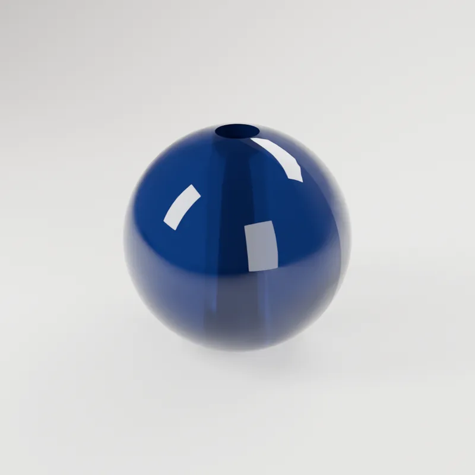
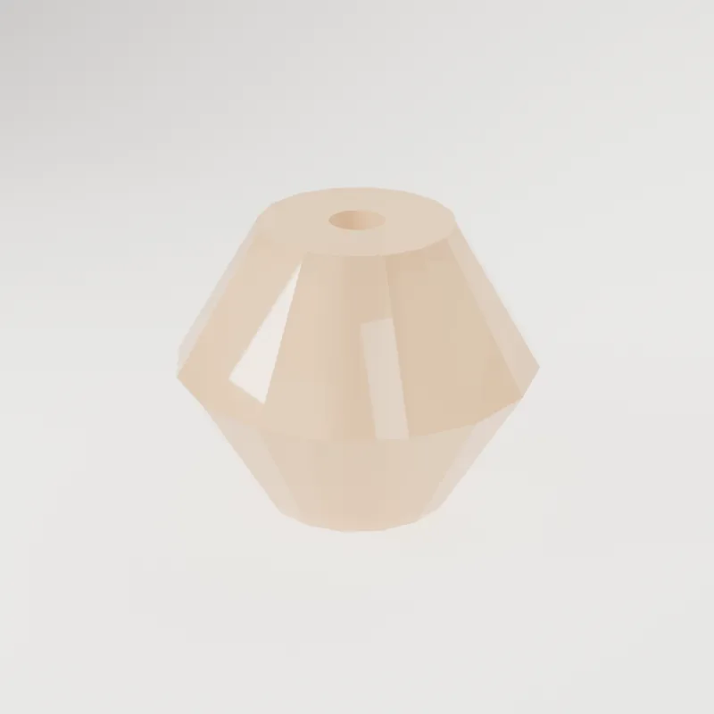
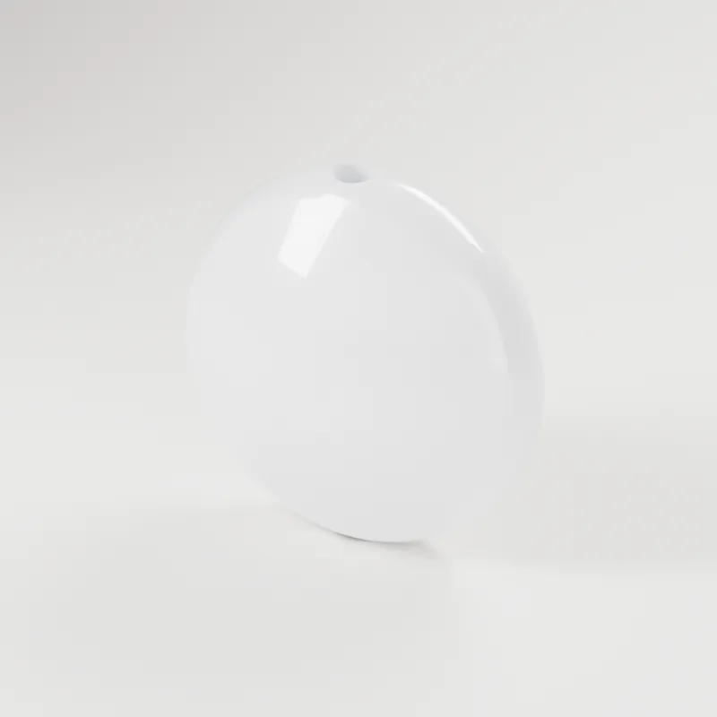
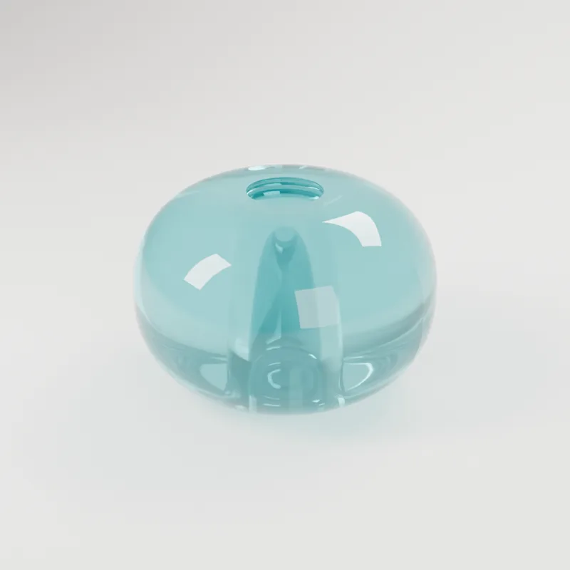
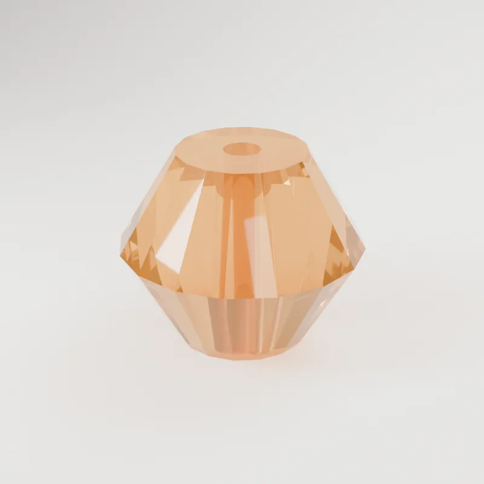
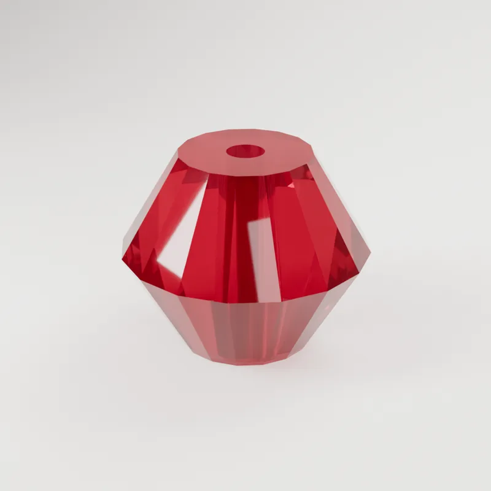
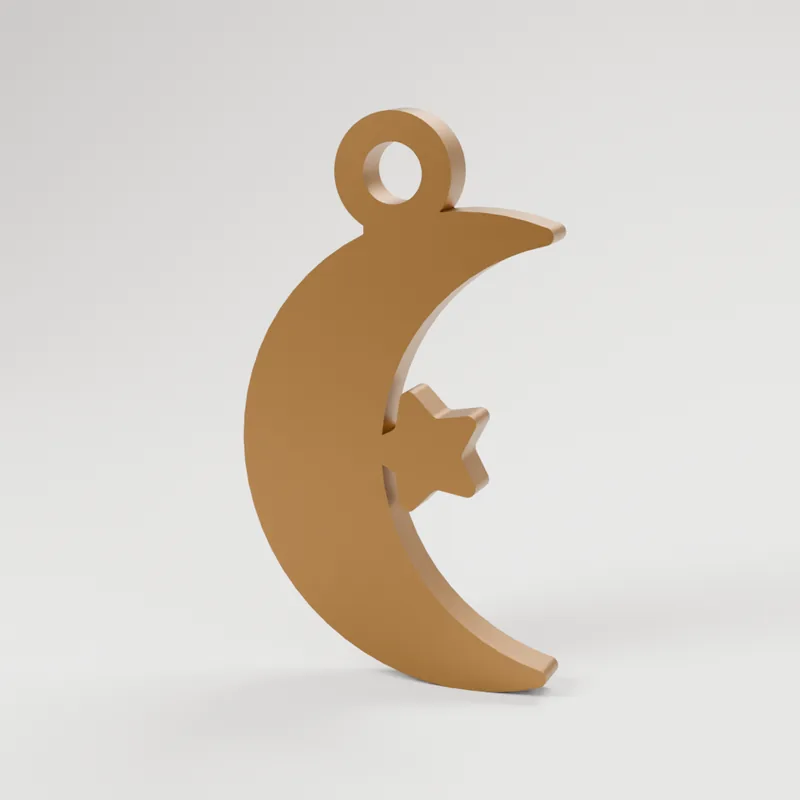
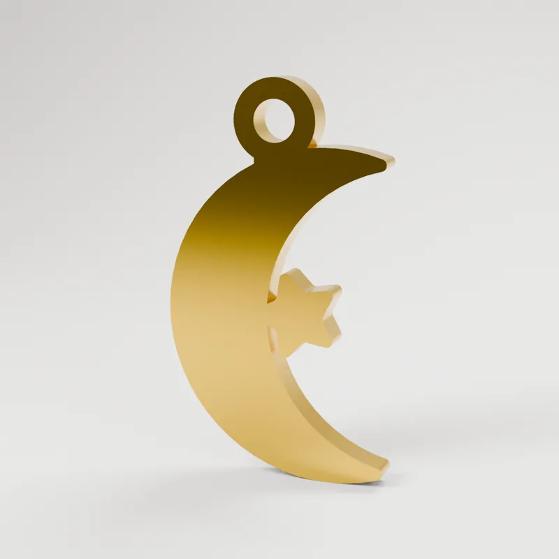
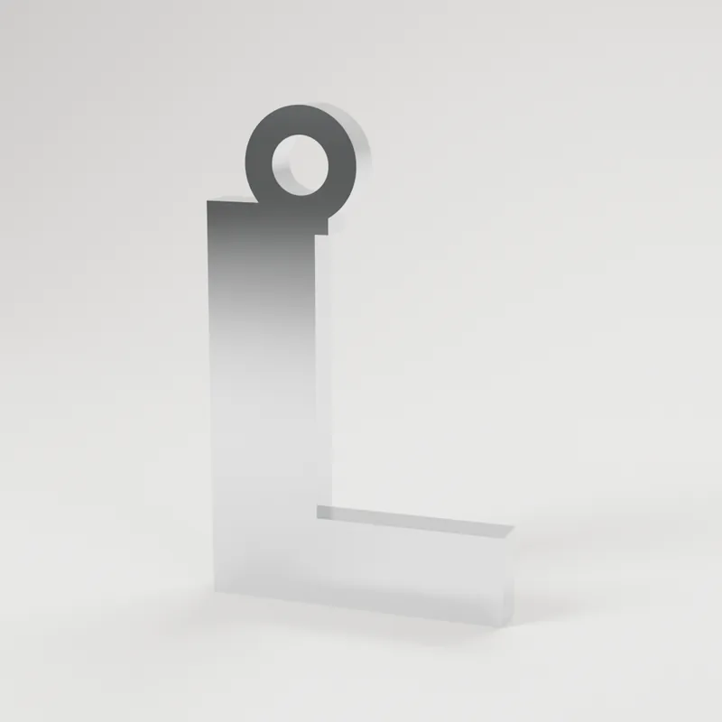
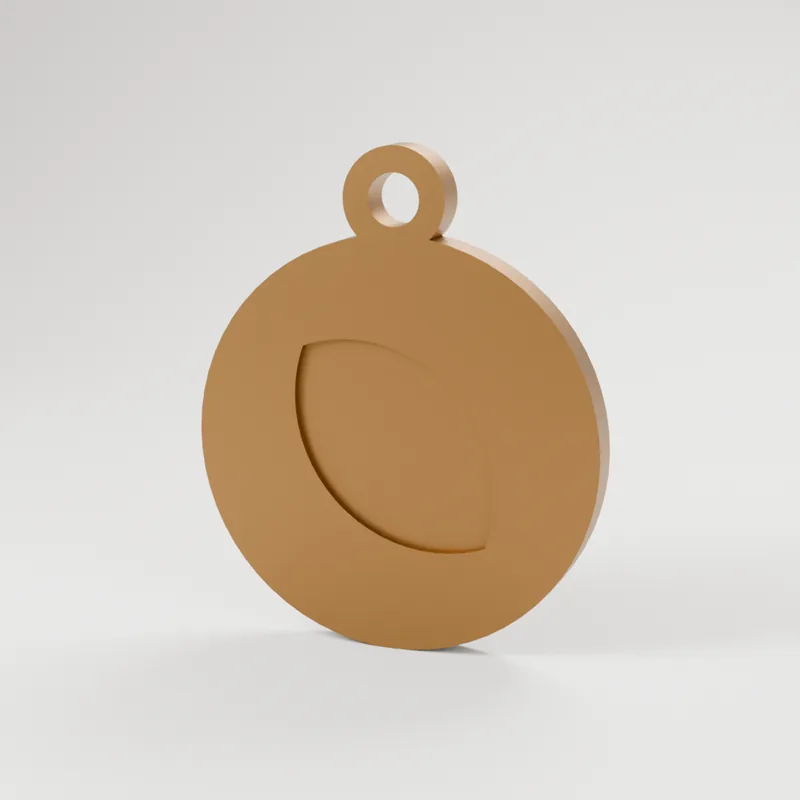

# Render gallery

Catalog renders made locally with the Bead Studio pipeline: CadQuery model, GLB,
Blender Cycles (decisions 0003, 0006 and 0011). The online demo shows these images;
renders run only on a machine with Blender. Rebuild with `scripts/build_gallery.py`.

Generated 2026-11-23; images 800 px WebP.

| | | |
|---|---|---|
|  **GB-1001** Midnight Lagoon Round Midnight Blue · 0.567 g |  **GB-1002** Desert Sand Faceted Desert Sand · 0.792 g |  **GB-1017** Morning Fog Lentil Opal White · 0.904 g |
|  **GB-1020** Sea Glass Rondelle Aqua · 0.186 g |  **GB-1034** Honey Glow Faceted Honey · 0.792 g |  **GB-1034** Honey Glow Faceted Ruby · 0.792 g |
|  **CH-2004** Crescent Moon & Star Antique bronze · 0.989 g |  **CH-2004** Crescent Moon & Star Gold plate · 0.989 g |  **CH-2004** Crescent Moon & Star Rhodium · 0.989 g |
|  **CH-2014** Block Initial (A-Z) Rhodium · 0.841 g |  **CH-2028** Amber Leaf Disc Antique bronze · 1.974 g |  |
